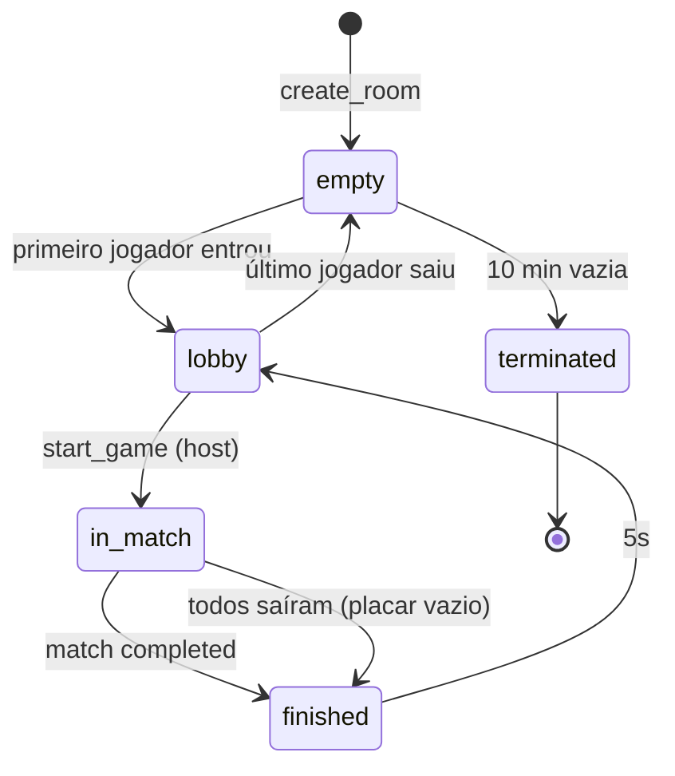
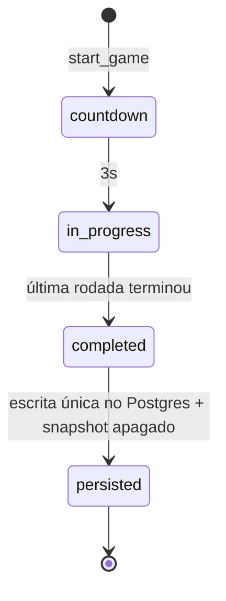
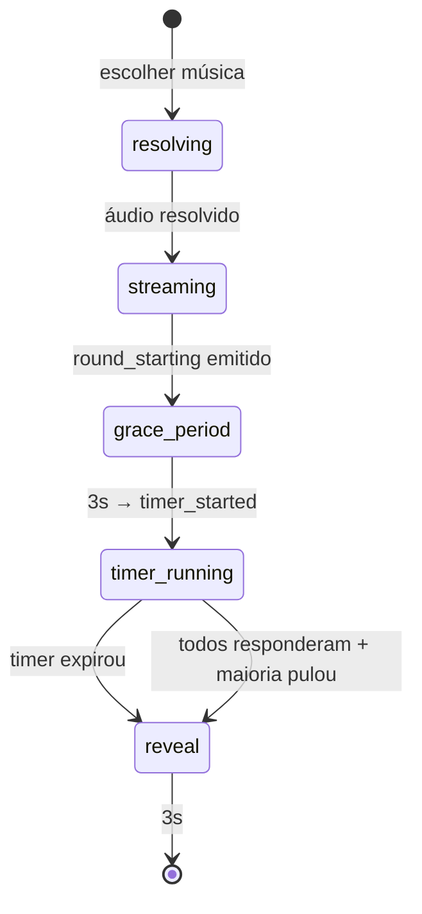
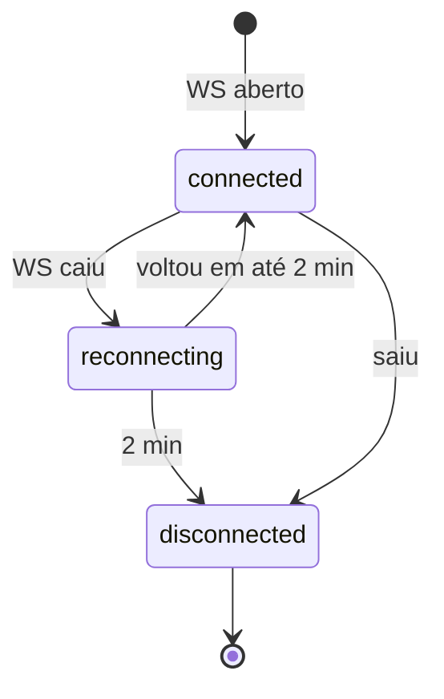

# Arquitetura

> Só o que **restringe** o código: fronteiras, onde vive cada estado e as máquinas de estado.
> Não há mapa de pastas aqui (ele apodrece). A estrutura real é a do repositório. As pastas de contexto da
> `apps/api` abaixo são fronteira, não mapa: o lint e o `docs:check` (`PENDING_SCOPE`) dependem delas.

## Bounded contexts e fronteiras

| Contexto | Onde | Papel |
|---|---|---|
| Game Engine (core) | `packages/domain` | Regras puras do GDD. Sem I/O. |
| Game Orchestrator | `apps/api/src/room` | `RoomRegistry`, `RoomActor`, `WsGateway`, timers, snapshot, recovery. Aplica os `Result` da engine. |
| Playlist Integration | `apps/api/src/playlist` (áudio em `playlist/audio`) | OAuth, importação, normalização para `NormalizedSong`, resolução de áudio. Anti-corruption layer: nada fora dele vê formato de plataforma. |
| Progression | `apps/api/src/progression` | Recordes do solo no MVP; XP e leaderboard depois. |
| Contratos | `packages/schema` | Zod, compartilhado por todos ([ADR-0014](adr/0014-contratos-zod-first.md)). |

Dependências permitidas (o lint garante, [ADR-0015](adr/0015-lint-com-oxlint.md)):

```
apps/web ──► packages/schema ◄── packages/domain ◄── apps/api
                    ▲                                    │
                    └────────────────────────────────────┘
```

- `packages/domain` importa só `packages/schema`.
- `apps/web` **nunca** importa `packages/domain`: a UI só reflete eventos do servidor.
- Dentro de `apps/api`, Playlist Integration não importa Orchestrator nem Engine ([ADR-0023](adr/0023-pastas-de-contexto-da-apps-api.md)).
- Fora dos contextos, a `apps/api` tem só camadas transversais: `src/http` (app Hono, middlewares, sessão, logger, rotas REST que compõem os contextos), `src/db` (schema Drizzle) e `src/observability` (métricas, Sentry).

## Onde vive cada estado

| Estado | Onde | Vida |
|---|---|---|
| Sala, partida e rodada em andamento | Memória do `RoomActor` (um processo por sala) | Enquanto a sala existir |
| Snapshot da sala em `in_match` | Redis `room:{invite_code}:snapshot`, a cada 5s | TTL 30 min; apagado ao persistir |
| Cache ISRC → Deezer | Redis `isrc:{isrc}:deezer` | TTL 24h |
| MP3 da rodada | Memória do `RoomActor`, por `round_id` | Até o fim da rodada |
| Contas OAuth, playlists, histórico, recordes | Postgres | Ver retenção em [`privacy.md`](privacy.md) |

- **Single-writer:** cada sala pertence a um único processo. Com N nodes, o Caddy roteia por hash do `invite_code` ([ADR-0002](adr/0002-servidor-hono-single-writer.md)).
- O Postgres **não** guarda partida em andamento. Recebe uma escrita única quando a partida chega a `completed`: config, placar por jogador e, por rodada e jogador, `is_correct`, `is_near_miss`, `points` e `response_time`. **Sem `answer_text`** (decidido em 2026-10-21, [`privacy.md`](privacy.md)).

## Máquinas de estado

Canônicas, decididas em 2026-10-21. Hierárquicas: cada agregado tem a sua, e a revelação pertence só ao `Round`. Transição fora destas retorna `err("illegal_state_transition")` e é logada.

### Room



- `terminated` é absorvente. O mesmo `invite_code` fica bloqueado por 30 min depois disso.
- Host desconectado por 60s → `host_changed`, sem mudar o estado (R-603).

### Match (existe enquanto a Room está em `in_match` ou `finished`)



### Round (existe enquanto o Match está em `in_progress`)



- Só se aceita resposta em `timer_running` (R-107). `response_time` conta a partir da entrada em `timer_running`.
- `is_correct` e `points_earned` só são calculados na entrada em `reveal`.
- Música sem áudio em `resolving` → próxima da reserva (R-307).

### Conexão do jogador (ortogonal à partida)



`afk` é um booleano à parte, não um estado.

### `phase` derivada (o que o cliente usa para escolher a tela)

| Room | Match | Round | `phase` |
|---|---|---|---|
| `lobby` | — | — | `lobby` |
| `in_match` | `countdown` | — | `countdown` |
| `in_match` | `in_progress` | `resolving`, `streaming`, `grace_period`, `timer_running` | `playing` |
| `in_match` | `in_progress` | `reveal` | `reveal` |
| `finished` | `completed`/`persisted` | — | `results` |

### Transição → evento WS

| Transição | Evento |
|---|---|
| jogador entrou ou voltou (`join_room`, 1ª mensagem do socket) | `room_state` para ele, `player_joined` para os outros |
| jogador escolheu playlist | `room_state` para todos (não há evento parcial de `has_playlist`) |
| Room `lobby → in_match` | `game_starting { countdown_seconds: 3 }` |
| Round `streaming → grace_period` | `round_starting` (com o `audio_token` de cada jogador) |
| Round `grace_period → timer_running` | `timer_started { duration_seconds, server_now }` |
| resposta aceita | `answer_confirmed` só para quem respondeu |
| Round `→ reveal` | `round_ended` |
| Match `→ completed` | `game_ended` |
| host trocado | `host_changed` |

## Recuperação

1. Ao subir, antes de aceitar conexões, o `RecoveryService` lê `room:*:snapshot` (SCAN) e recria cada `RoomActor`, com todos os jogadores em `reconnecting`.
2. Quem reconecta em até 2 min recebe `room_state` e continua. A perda máxima é de 5s.
3. Snapshot com mais de 2 min de idade: sala expirada.
4. Deploy no MVP é hard-cut em horário de pouco uso; a recuperação acima cobre ([`operations.md`](operations.md)).
